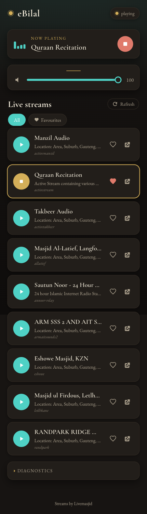

# eBilal

Turn a Raspberry Pi into a dedicated player for [Livemasjid.com](https://livemasjid.com) live streams. A quiet, always-on alternative to Radio Bilal: it listens for your favourite masjid streams going live and plays them automatically, with a clean web interface for control from any phone or browser on your network.

<p align="center">
  
</p>

## Features

- **Auto-play on live**: subscribes to your chosen streams over MQTT and starts playing the moment they go live.
- **Web player**: a warm, mobile-first interface with a now-playing view, live station list, favourites, and a volume slider. Light and dark themes follow your device.
- **Favourites**: heart the streams you care about and filter the list to just those.
- **REST API**: everything the UI does is available over a documented API, so you can script or integrate it.
- **Pirate Radio ready**: optional [Pimoroni pHAT BEAT](https://shop.pimoroni.com/products/pirate-radio-pi-zero-w-project-kit) support for physical play/volume/skip buttons.
- **Light on resources**: runs comfortably on a Raspberry Pi Zero W.

## Hardware

- Any Raspberry Pi (tested on a Pi Zero W).
- A way to get audio out: the 3.5mm jack, a USB DAC, an I2S amp such as the [Adafruit MAX98357](https://learn.adafruit.com/adafruit-max98357-i2s-class-d-mono-amp/raspberry-pi-usage), or a Pimoroni pHAT BEAT.

## Installation

### The quick way

```bash
wget https://raw.githubusercontent.com/Muslims-in-IT/ebilal/main/setup.sh
bash setup.sh
```

### The considered way

1. Install the latest [Raspberry Pi OS Lite](https://www.raspberrypi.com/software/operating-systems/).
2. Set up [Wi-Fi and SSH](https://www.raspberrypi.com/documentation/computers/configuration.html#setting-up-a-headless-raspberry-pi) (headless).
3. Boot and SSH in.
4. Download the setup script: `wget https://raw.githubusercontent.com/Muslims-in-IT/ebilal/main/setup.sh`
5. Read it: `cat setup.sh`
6. Run it, or run the steps yourself: `bash setup.sh`

The script installs dependencies, creates an `ebilal` service user, sets up a systemd service, and configures nginx to serve the web interface on port 80 with the API proxied under `/api`.

## Usage

Once running:

- **Web interface**: open `http://<pi-ip-address>/` (or `http://ebilal.local/` if your hostname is `ebilal`).
- **API docs**: `http://<pi-ip-address>:8000/docs`

Pick your favourite streams with the heart icon. When one of them goes live, eBilal tunes in on its own. You can also tap any live stream to play it immediately.

### Configuration

Settings live in `/opt/ebilal/settings.toml`:

| Key | Meaning |
| --- | --- |
| `server_url` | Base URL of the Icecast server (Livemasjid). |
| `mounts` | Your favourite mount names (auto-played when live). |
| `audio_device` | ALSA mixer/device name, or empty for the default. |
| `loglevel` | `INFO` for normal use, `DEBUG` when troubleshooting. |
| `pimoroni` | `true` to enable pHAT BEAT buttons. |

## API

Base path: `/api` (proxied by nginx), or directly on port `8000`.

| Method | Endpoint | Description |
| --- | --- | --- |
| `GET` | `/favourites` | List favourite mounts. |
| `POST` | `/favourites` | Set favourite mounts (`{"favourites": [...]}`). |
| `GET` | `/volume` | Current volume (0–100). |
| `POST` | `/volume?volume=N` | Set volume. |
| `GET` | `/player` | Player state (`status`, `mount`). |
| `GET` | `/player/play/{mount}` | Play a mount. |
| `GET` | `/player/stop` | Stop playback. |
| `GET` | `/mounts` | All known mounts and their states. |

Interactive documentation is served at `/docs`.

## How it works

```
Livemasjid MQTT  ──▶  eBilal daemon  ──▶  ffplay (audio out)
(stream status)       (Python/FastAPI)        │
                            │                  ▼
                            │            ALSA / your DAC
                            ▼
                      REST API (:8000)
                            │
                      nginx (:80) ──▶  web interface
```

The daemon connects to Livemasjid's MQTT broker and watches for your favourite mounts going live. When one does, it launches `ffplay` to stream it. A FastAPI service exposes control over HTTP, and nginx serves the static web interface while proxying the API.

## Troubleshooting

- **Check the service**: `sudo systemctl status ebilal.service`
- **Watch logs**: `journalctl -u ebilal.service -f`
- **No sound**: confirm your audio device with `aplay -l` and set `audio_device` in `settings.toml`.
- **Nothing auto-plays**: make sure at least one of your `mounts` is actually live, and that the daemon reports `Connected with result code 0` in the logs.

## License

Licensed under AGPL-3.0-or-later. See [LICENSE.txt](LICENSE.txt).
