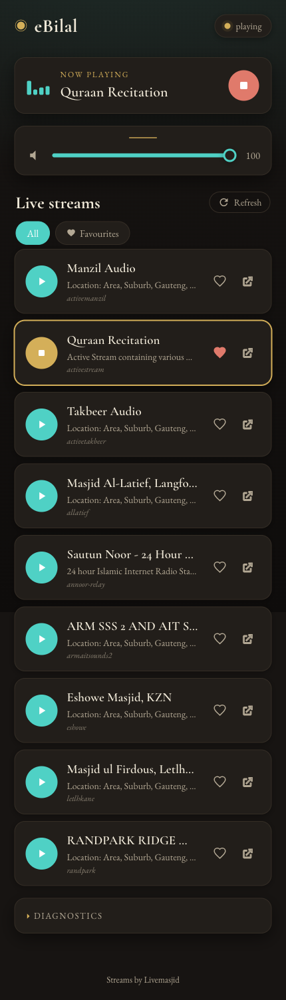

# eBilal

Turn a Raspberry Pi into a dedicated player for [Livemasjid.com](https://livemasjid.com) live streams. A quiet, always-on alternative to Radio Bilal: it listens for your favourite masjid streams going live and plays them automatically, with a clean web interface for control from any phone or browser on your network.

<p align="center">
  
</p>

## Features

- **Auto-play on live**: pick your masjid streams with the autoplay button and eBilal plays them the moment they go live, all by itself.
- **Web player and installable app**: a warm, mobile-first interface that installs to your phone's home screen (PWA). Light and dark themes follow your device.
- **Three tidy sections**: *Pinned* (arrange the UI, Quraan recitation is pinned out of the box), *Autoplay* (what plays on the device), and *All streams*, filterable by online/offline and searchable.
- **Secure local connection**: each device makes its own HTTPS certificate, so after a one-time setup per phone there is no "Not secure" warning.
- **One-line install** on any Raspberry Pi, Debian or Ubuntu machine, and in-app software updates.
- **REST API**: everything the UI does is available over a documented API.
- **Pirate Radio ready**: optional [Pimoroni pHAT BEAT](https://shop.pimoroni.com/products/pirate-radio-pi-zero-w-project-kit) support for physical play/skip/volume buttons.
- **Light on resources**: runs comfortably on a Raspberry Pi Zero W.

## Hardware

- Any Raspberry Pi (tested on a Pi Zero W), or any Debian/Ubuntu machine with an audio output.
- A way to get audio out: the 3.5mm jack, a USB DAC, an I2S amp such as the [Adafruit MAX98357](https://learn.adafruit.com/adafruit-max98357-i2s-class-d-mono-amp/raspberry-pi-usage), or a Pimoroni pHAT BEAT.

## Installation

1. Flash [Raspberry Pi OS Lite](https://www.raspberrypi.com/software/) with Raspberry Pi Imager. In its settings, set the hostname to `ebilal`, and fill in your Wi-Fi and enable SSH.
2. Boot, SSH in (`ssh <user>@ebilal.local`) and run:

```bash
curl -fsSL https://raw.githubusercontent.com/Muslims-in-IT/ebilal/main/setup.sh | sudo bash
```

With a Pimoroni pHAT BEAT, or to choose the network name:

```bash
curl -fsSL https://raw.githubusercontent.com/Muslims-in-IT/ebilal/main/setup.sh | sudo bash -s -- --pimoroni --hostname ebilal
```

Prefer to read it first? `curl -fsSLO .../setup.sh && less setup.sh && sudo bash setup.sh`.

The installer is safe to re-run (it upgrades and never touches your settings). It installs dependencies, creates an `ebilal` service user and systemd service, sets up nginx on ports 80 and 443 with a local certificate, and switches off Wi-Fi power saving (which makes a Pi Zero W drop off the network).

## Usage

- **Web interface**: open `http://ebilal.local/` on any phone or computer on the same Wi-Fi (or `http://<ip-address>/`).
- **Secure connection and app install**: once per device, open `http://ebilal.local/trust.html` and follow the steps for your phone or computer. After that eBilal opens at `https://ebilal.local/` with no warning and can be added to the home screen. The certificate is made by your own eBilal and can only vouch for local network addresses.
- **API docs**: `http://ebilal.local:8000/docs`

Tap the autoplay button on the streams you want eBilal to play by itself. Use the pin to keep a stream at the top of the page. You can also tap any live stream to play it immediately.

### Configuration

Settings live in `/opt/ebilal/settings.toml` (the web UI edits most of them for you):

| Key | Meaning |
| --- | --- |
| `server_url` | Base URL of the Icecast server (Livemasjid). |
| `mounts` | Autoplay streams: played automatically when they go live. |
| `pinned` | Streams pinned to the top of the web UI (default: Quraan recitation). |
| `volume` | Playback volume, 0-100. |
| `audio_device` | ALSA mixer/device name, or empty for the default. |
| `loglevel` | `INFO` for normal use, `DEBUG` when troubleshooting. |
| `pimoroni` | `true` to enable pHAT BEAT buttons. |

## API

Base path: `/api` (proxied by nginx), or directly on port `8000`.

| Method | Endpoint | Description |
| --- | --- | --- |
| `GET` | `/favourites` | List autoplay mounts. |
| `POST` | `/favourites` | Set autoplay mounts (`{"favourites": [...]}`). |
| `GET` | `/pinned` | List pinned mounts. |
| `POST` | `/pinned` | Set pinned mounts (`{"pinned": [...]}`). |
| `GET` | `/volume` | Current volume (0–100). |
| `POST` | `/volume?volume=N` | Set volume. |
| `GET` | `/player` | Player state (`status`, `mount`). |
| `GET` | `/player/play/{mount}` | Play a mount. |
| `GET` | `/player/stop` | Stop playback. |
| `POST` | `/player/toggle` | Play/pause (as the hardware button). |
| `POST` | `/player/next` | Next live stream, autoplay ones first. |
| `POST` | `/player/prev` | Previous live stream. |
| `GET` | `/mounts` | All known mounts and their states. |

Interactive documentation is served at `/docs`.

## How it works

```
Livemasjid MQTT  ──▶  eBilal daemon  ──▶  ffplay (audio out)
(stream status)       (Python/FastAPI)        │
                            │                  ▼
                            │            ALSA / your DAC
                            ▼
                      REST API (:8000)
                            │
                      nginx (:80) ──▶  web interface
```

The daemon connects to Livemasjid's MQTT broker and watches for your favourite mounts going live. When one does, it launches `ffplay` to stream it. A FastAPI service exposes control over HTTP, and nginx serves the static web interface while proxying the API.

## Troubleshooting

- **Check the service**: `sudo systemctl status ebilal.service`
- **Watch logs**: `journalctl -u ebilal.service -f`
- **No sound**: confirm your audio device with `aplay -l` and set `audio_device` in `settings.toml`.
- **Device keeps disappearing from the network** (Pi Zero W): Wi-Fi power saving must be off. Check with `iw wlan0 get power_save`; the installer adds `wifi-powersave-off.service` to keep it off.
- **Browser says "Not secure"**: do the one-time setup at `http://ebilal.local/trust.html` on that device.
- **Nothing auto-plays**: make sure at least one of your `mounts` is actually live, and that the daemon reports `Connected with result code 0` in the logs.

## License

Licensed under AGPL-3.0-or-later. See [LICENSE.txt](LICENSE.txt).
